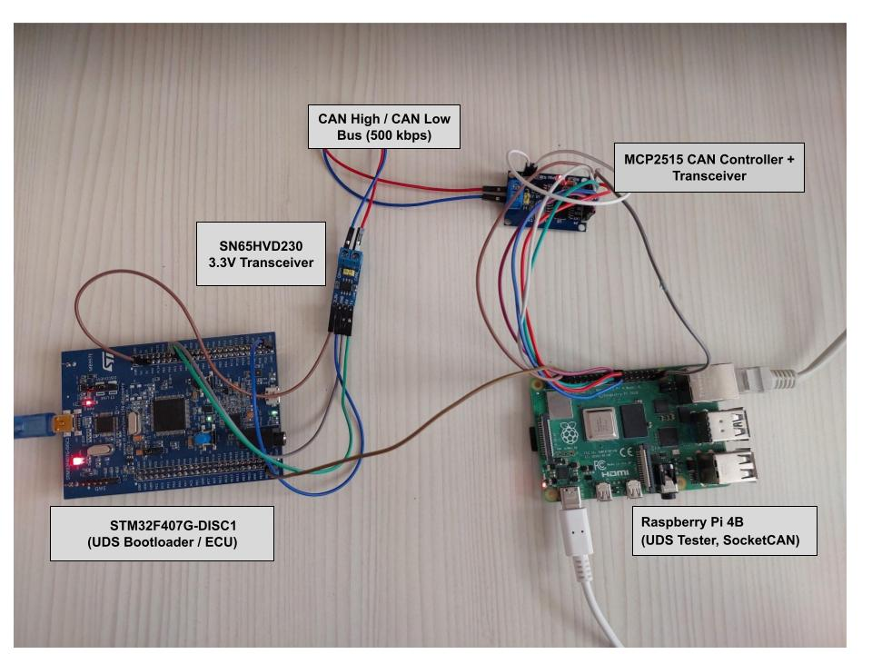

# stm32-uds-bootloader

A CAN bootloader for STM32F407 implementing UDS (ISO 14229-1) over ISO-TP (ISO 15765-2) for firmware updates, written from scratch (no third-party ISO-TP/UDS libraries).

> **Status:** the firmware update pipeline works end-to-end on real hardware, and the previously unreliable boot jump has been root-caused and fixed (see [Boot jump: root cause and fix](#boot-jump-root-cause-and-fix)). A repeated end-to-end test with CAN-delivered images is still pending.

## Why this project

Field firmware updates over CAN are standard in automotive ECUs. The interesting engineering problem isn't "send bytes over CAN" — it's segmenting a multi-KB image into 8-byte CAN frames correctly, running a stateful diagnostic session on top of that, writing flash safely, and handing off execution to new code without leaving the CPU in a broken state. This project builds that path by hand: ISO-TP segmentation/reassembly, a UDS service state machine, a flash driver, CRC32-based integrity verification and the jump into the application.

It follows my earlier [vehicle CAN bus simulator](https://github.com/GamzeAkcay/stm32-can-node) project (STM32 + Raspberry Pi, SocketCAN).

## Architecture

```
 Raspberry Pi (UDS tester)                     STM32F407 (UDS bootloader / ECU)
 ┌───────────────────────────────┐            ┌──────────────────────────────┐
 │ firmware.bin + CRC32          │            │ Bootloader                   │
 │ ISO-TP segmentation           │  CAN bus   │  UDS server, ISO-TP RX,      │
 │ UDS client (request/response) │◄──────────►│  flash driver, CRC check,    │
 │ python-can / SocketCAN        │            │  boot decision               │
 └───────────────────────────────┘            ├──────────────────────────────┤
                                               │ Application (updatable)      │
                                               └──────────────────────────────┘
```

### Flash layout (STM32F407VG, 1 MB flash)

| Sector(s) | Address range           | Purpose                              |
|-----------|--------------------------|---------------------------------------|
| 0–1       | 0x08000000 – 0x08007FFF  | Bootloader (32 KB)                    |
| 2–10      | 0x08008000 – 0x080DFFFF  | Application (updatable)               |
| 11        | 0x080E0000 – 0x080FFFFF  | Metadata (magic, size, CRC32)         |

On `0x34 RequestDownload`, the metadata is erased **before** the application sectors, so an interrupted update leaves no valid record. After the transfer, the metadata's magic word is written **last**, after size and CRC — so a power loss mid-write leaves the metadata block invalid rather than silently wrong.

### Boot decision

1. Bootloader starts after reset, opens a ~2 s window for a UDS session.
2. If a programming session is requested, stay in the bootloader.
3. Otherwise, check application metadata (magic + size bounds + CRC32 match) and jump to the application only if the check passes.

## Supported UDS services

| SID  | Service                  | Status |
|------|---------------------------|--------|
| 0x10 | DiagnosticSessionControl | ✅ done (programming session 0x02 only) |
| 0x34 | RequestDownload          | ✅ done (simplified format) |
| 0x36 | TransferData             | ✅ done (variable block size, block-counter validated) |
| 0x37 | RequestTransferExit      | ✅ done |
| 0x31 | RoutineControl           | ✅ done (used for CRC32 verification) |
| 0x11 | ECUReset                 | ✅ done |

## Boot jump: root cause and fix

**Symptom.** After a successful update, the jump from the bootloader to the application failed most of the time. It worked once after adding flash cache resets, which led to the wrong theory that the ART cache was the cause.

**Investigation.** Using the debugger and STM32CubeIDE's Fault Analyzer, the CPU ended up in the application's `HardFault_Handler` before the application's `SystemInit` ran. The fault was a forced HardFault from a **precise data bus error**, with **BFAR = 0x20020000**, one byte past the end of SRAM (`0x20000000–0x2001FFFF`).

**Root cause.** `0x20020000` is the application's initial stack pointer. The disassembly of `JumpToApplication()` showed:

```
msr    MSP, r1            ; MSP = 0x20020000 (application stack)
str    r3, [r1, #8]       ; SCB->VTOR = 0x08008000
cpsie  i                  ; __enable_irq()
ldmia.w sp!, {r4, lr}     ; compiler-generated epilogue: reads 0x20020000/0x20020004 -> bus fault
bx     r2                 ; jump to application (never reached)
```

After `__set_MSP()`, the compiler restored the function's saved registers from the stack before the tail-call jump. With MSP already pointing to the end of RAM, that read went outside SRAM. Small code changes (such as the cache resets) changed the generated epilogue, which explains why it once worked.

**Fix.**
- Setting MSP and branching to the application are done in one inline assembly block, so nothing touches the stack after MSP changes.
- SysTick is disabled **after** `HAL_RCC_DeInit()` (which re-enables it via `HAL_InitTick()`), and a pending SysTick is cleared via `SCB->ICSR`.
- `__DSB()` / `__ISB()` after updating `SCB->VTOR`.

**Verification (application loaded via ST-Link).**
- Direct jump test (metadata check bypassed): 15/15 resets booted the application.
- Normal boot with CRC32 metadata validation: 5/5 resets booted the application.
- Metadata with a wrong CRC32: the bootloader correctly refused to jump.

## Hardware



- STM32F407G-DISC1 (UDS bootloader / ECU)
- SN65HVD230 3.3V CAN transceiver
- MCP2515 CAN controller + transceiver module, Raspberry Pi 4B (UDS tester, SocketCAN, runs the update client)
- CAN bus at 500 kbps

## Build and run

```bash
# Bootloader and application are both STM32CubeIDE projects
# Build bootloader/ and app/ separately in CubeIDE (or via headless make)

# Update client (Raspberry Pi) — host/update_client.py, to be added to this repository
cd host
python3 update_client.py   # delivers app/Debug/stm32_app.bin over CAN
```

## Verified so far

Delivered a real, compiled ~36–38 KB `stm32_app.bin` entirely over CAN from a Raspberry Pi, and confirmed via CubeIDE's Memory view that:

- ISO-TP correctly reassembles multi-frame transfers (SF/FF/CF/FC) for both request and ~64-byte data blocks
- 0x34 → repeated 0x36 → 0x37 → 0x31(CRC) completes with positive responses at every step
- Flash is erased and written at the correct addresses (0x08008000 onward)
- Metadata (size + CRC32) lands correctly at 0x080E0000 and matches a CRC32 computed independently in Python (`zlib.crc32`), confirming the hand-written CRC32 implementation is correct
- `update_client.py` reports elapsed time/throughput for the transfer — measured over 5 runs, see [Results](#results)

This is the hard part of a bootloader — getting a real binary across CAN intact and verified — and it works repeatably.

## Known issues

**End-to-end retest pending.** The boot jump fix has been verified with the application loaded via ST-Link. Repeated tests with CAN-delivered images will follow.

**Power-loss recovery is unverified.** The mechanism exists (magic word written last) but has never been tested against an actual power cut mid-transfer.

**Throughput is limited by round trips.** Each ~64-byte TransferData block waits for Flow Control and a positive response, so most of the time is spent waiting rather than transmitting. See [Results](#results).

## Testing

- **Unit tests:** ISO-TP receive path only (`bootloader/tests/test_isotp.c`, runs on host via gcc with a mock CAN send).
- **Hardware tests:** full UDS/flash/CRC pipeline manually verified multiple times with real firmware images (see above); boot jump and CRC validation verified as described in [Boot jump: root cause and fix](#boot-jump-root-cause-and-fix). No automated hardware-in-the-loop tests yet.
- **CI:** none yet.

## Results

Measured on the hardware setup above: STM32F407G-DISC1 ↔ Raspberry Pi 4B, CAN bus at 500 kbps, image size 36864 bytes (36 KB, CRC32 `0x40CD96D5`), 5 consecutive update runs (flash erased and rewritten each time).

| Run | Time (s) | Throughput (KB/s) |
|-----|----------|--------------------|
| 1   | 8.4      | 4.3                |
| 2   | 8.2      | 4.4                |
| 3   | 8.2      | 4.4                |
| 4   | 8.4      | 4.3                |
| 5   | 8.2      | 4.4                |

| Metric                              | Value                          |
|--------------------------------------|--------------------------------|
| Firmware delivered over CAN          | 36 KB, verified via CRC32 (`0x40CD96D5`) |
| Update time (mean ± std dev, n=5)    | 8.28 s ± 0.10 s                |
| Throughput (mean, n=5)               | 4.36 KB/s                      |
| Boot jump                            | 15/15 direct, 5/5 with CRC validation (ST-Link loaded) |
| Recovery success after power loss    | Not tested                     |

Throughput is low relative to the 500 kbps bus. ISO-TP's practical ceiling is roughly 26 KB/s (7 payload bytes per consecutive frame), but each ~64-byte TransferData block waits for two round trips (Flow Control and the positive response) rather than streaming continuously. Larger blocks should reduce this significantly; the latency on the tester side has not been measured yet.

## Roadmap

- [x] Linker scripts for bootloader and application partitions
- [x] ISO-TP receive (hand-written, unit-tested) and single-frame transmit
- [x] UDS services (0x10, 0x31, 0x34, 0x36, 0x37, 0x11)
- [x] Flash erase/write driver
- [x] CRC32 verification and metadata handling
- [x] Python update client
- [x] Measurements — throughput/timing (5 runs)
- [x] Reliable jump from bootloader to application — root cause found and fixed
- [ ] End-to-end retest with CAN-delivered images
- [ ] Power-loss recovery — mechanism exists, untested
- [ ] Respond with NRC 0x11 for unsupported services
- [ ] UDS session manager with S3 timeout and 0x3E TesterPresent
- [ ] Response pending (NRC 0x78) during flash erase, P2/P2* timing
- [ ] Standard programming sequence and 0x27 SecurityAccess
- [ ] ISO-TP multi-frame transmit
- [ ] Throughput: measure round-trip latency and increase TransferData block size
- [ ] Unit tests and CI beyond ISO-TP
- [ ] Interoperability test against Linux can-isotp and udsoncan
- [ ] Demo video
- [ ] 0x29 Authentication with ECDSA signature verification

## Repository layout

```
bootloader/   bootloader firmware (ISO-TP, UDS, flash driver, boot logic)
app/          example application (updatable firmware)
host/         Python update client (update_client.py, to be added)
docs/         diagrams, screenshots
```

## License

MIT
