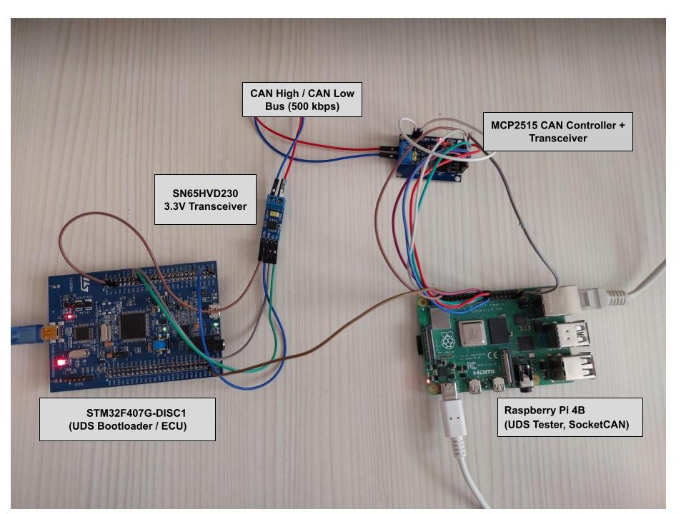

# stm32-uds-bootloader

A CAN bootloader for STM32F407 implementing UDS (ISO 14229-1) over ISO-TP (ISO 15765-2) for firmware updates, written from scratch (no third-party ISO-TP/UDS libraries).

> **Status:** the firmware update pipeline works end-to-end on real hardware, and the previously unreliable boot jump has been root-caused and fixed (see [Boot jump: root cause and fix](#boot-jump-root-cause-and-fix)). Power-loss behavior was tested in three scenarios (see [Power-loss testing](#power-loss-testing)). A larger repeated end-to-end test with CAN-delivered images is still pending.

## Why this project

Field firmware updates over CAN are standard in automotive ECUs. The interesting engineering problem isn't "send bytes over CAN" — it's segmenting a multi-KB image into 8-byte CAN frames correctly, running a stateful diagnostic session on top of that, writing flash safely, and handing off execution to new code without leaving the CPU in a broken state. This project builds that path by hand: ISO-TP segmentation/reassembly, a UDS service state machine, a flash driver, CRC32-based integrity verification and the jump into the application.

It follows my earlier [vehicle CAN bus simulator](https://github.com/GamzeAkcay/stm32-can-node) project (STM32 + Raspberry Pi, SocketCAN).

## Architecture

```
 Raspberry Pi (UDS tester)                     STM32F407 (UDS bootloader / ECU)
 ┌───────────────────────────────┐            ┌──────────────────────────────┐
 │ firmware.bin + CRC32          │            │ Bootloader                   │
 │ ISO-TP segmentation           │  CAN bus   │  UDS server, ISO-TP RX,      │
 │ UDS client (request/response) │◄──────────►│  flash driver, CRC check,    │
 │ python-can / SocketCAN        │            │  boot decision               │
 └───────────────────────────────┘            ├──────────────────────────────┤
                                               │ Application (updatable)      │
                                               └──────────────────────────────┘
```

### Flash layout (STM32F407VG, 1 MB flash)

| Sector(s) | Address range           | Purpose                              |
|-----------|--------------------------|---------------------------------------|
| 0–1       | 0x08000000 – 0x08007FFF  | Bootloader (32 KB)                    |
| 2–10      | 0x08008000 – 0x080DFFFF  | Application (updatable)               |
| 11        | 0x080E0000 – 0x080FFFFF  | Metadata (magic, size, CRC32)         |

On `0x34 RequestDownload`, the metadata is erased **before** the application sectors, so an interrupted update leaves no valid record. After the transfer, the metadata's magic word is written **last**, after size and CRC — so a power loss mid-write leaves the metadata block invalid rather than silently wrong.

### Boot decision

1. Bootloader starts after reset, opens a ~2 s window for a UDS session.
2. If a programming session is requested, stay in the bootloader.
3. Otherwise, check application metadata (magic + size bounds + CRC32 match) and jump to the application only if the check passes.

## Supported UDS services

| SID  | Service                  | Status |
|------|---------------------------|--------|
| 0x10 | DiagnosticSessionControl | ✅ done (programming session 0x02 only) |
| 0x34 | RequestDownload          | ✅ done (simplified format) |
| 0x36 | TransferData             | ✅ done (variable block size, block-counter validated) |
| 0x37 | RequestTransferExit      | ✅ done |
| 0x31 | RoutineControl           | ✅ done (used for CRC32 verification) |
| 0x11 | ECUReset                 | ✅ done |

## Boot jump: root cause and fix

**Symptom.** After a successful update, the jump from the bootloader to the application failed most of the time. It worked once after adding flash cache resets, which led to the wrong theory that the ART cache was the cause.

**Investigation.** Using the debugger and STM32CubeIDE's Fault Analyzer, the CPU ended up in the application's `HardFault_Handler` before the application's `SystemInit` ran. The fault was a forced HardFault from a **precise data bus error**, with **BFAR = 0x20020000**, one byte past the end of SRAM (`0x20000000–0x2001FFFF`).

**Root cause.** `0x20020000` is the application's initial stack pointer. The disassembly of `JumpToApplication()` showed:

```
msr    MSP, r1            ; MSP = 0x20020000 (application stack)
str    r3, [r1, #8]       ; SCB->VTOR = 0x08008000
cpsie  i                  ; __enable_irq()
ldmia.w sp!, {r4, lr}     ; compiler-generated epilogue: reads 0x20020000/0x20020004 -> bus fault
bx     r2                 ; jump to application (never reached)
```

After `__set_MSP()`, the compiler restored the function's saved registers from the stack before the tail-call jump. With MSP already pointing to the end of RAM, that read went outside SRAM. Small code changes (such as the cache resets) changed the generated epilogue, which explains why it once worked.

**Fix.**
- Setting MSP and branching to the application are done in one inline assembly block, so nothing touches the stack after MSP changes.
- SysTick is disabled **after** `HAL_RCC_DeInit()` (which re-enables it via `HAL_InitTick()`), and a pending SysTick is cleared via `SCB->ICSR`.
- `__DSB()` / `__ISB()` after updating `SCB->VTOR`.

**Verification (application loaded via ST-Link).**
- Direct jump test (metadata check bypassed): 15/15 resets booted the application.
- Normal boot with CRC32 metadata validation: 15/15 resets booted the application.
- Metadata with a wrong CRC32: the bootloader correctly refused to jump.

## Power-loss testing

Tested on 2026-11-13: STM32F407G-DISC1 powered through its ST-LINK USB cable, update client on a Raspberry Pi 4B (CAN, 500 kbit/s), 36 KB application image. "Power cut" means unplugging the board's USB cable while the update client was running. Each scenario was run once.

| # | Scenario | Type | Result |
|---|----------|------|--------|
| 1 | Power cut during flash erase (`0x34` RequestDownload) | real | After reconnecting, the bootloader did not jump and stayed in the bootloader. The next update completed and the application started. |
| 2 | Power cut in the middle of the transfer (around block 256 of 576, `0x36`) | real | Same as scenario 1. |
| 3 | Complete image written, update client stopped before the CRC verification routine (`0x31`) | simulated | The bootloader did not jump, although the flash content was byte-identical to a previously valid image. |

A full update after each case succeeded and the application started (LED blinking).

Limits of these tests:

- Each scenario was run once, with a manual cable pull. This is not a statistical result.
- Scenario 3 is a simulation (the client was stopped), not a real power cut.
- A power cut during the three metadata word writes was not tested on hardware. The write order (size, CRC, magic last) should leave invalid metadata in every such case, but this is a design property, not a measured result.
- The jump to the application was confirmed by an LED only.

## Hardware



- STM32F407G-DISC1 (UDS bootloader / ECU)
- SN65HVD230 3.3V CAN transceiver
- MCP2515 CAN controller + transceiver module, Raspberry Pi 4B (UDS tester, SocketCAN, runs the update client)
- CAN bus at 500 kbps

## Build and run

```bash
# Bootloader and application are both STM32CubeIDE projects
# Build bootloader/ and app/ separately in CubeIDE (or via headless make)

# Update client (Raspberry Pi, requires python-can): bring up SocketCAN, then run the client from host/
sudo ip link set can0 up type can bitrate 500000
cd host
python3 update_client.py <path/to/stm32_app.bin> [can0]   # waits up to 30 s for the bootloader (press RESET if needed)
```

## Verified so far

Delivered a real, compiled ~36–38 KB `stm32_app.bin` entirely over CAN from a Raspberry Pi, and confirmed via CubeIDE's Memory view that:

- ISO-TP correctly reassembles multi-frame transfers (SF/FF/CF/FC) for both request and ~64-byte data blocks
- 0x34 → repeated 0x36 → 0x37 → 0x31(CRC) completes with positive responses at every step
- Flash is erased and written at the correct addresses (0x08008000 onward)
- Metadata (size + CRC32) lands correctly at 0x080E0000 and matches a CRC32 computed independently in Python (`zlib.crc32`), confirming the hand-written CRC32 implementation is correct
- `update_client.py` reports elapsed time/throughput for the transfer — measured over 5 runs, see [Results](#results)

This is the hard part of a bootloader — getting a real binary across CAN intact and verified — and it works repeatably.

## Known issues

**End-to-end retest is small so far.** The boot jump fix was verified 15/15 with the application loaded via ST-Link. With CAN-delivered images, three updates (including the recoveries after power cuts) booted the application; a repeated test of 10 or more runs is still pending.

**Power-loss behavior is only partly tested.** Three scenarios were run once each (see [Power-loss testing](#power-loss-testing)). A power cut during the three metadata word writes themselves has not been tested on hardware.

**Throughput is far below the bus capacity.** Removing the tester's 1 ms pause after each consecutive frame improved it from 4.36 to 8.10 KB/s (n=5), so the pause was a large part of the problem but not all of it: about 7.7 ms per 64-byte block remain, against roughly 3 ms of bus time. The remaining overhead has not been measured yet (flow control and response waits, flash writes, tester latency). STmin/BlockSize are not implemented. See [Results](#results).

## Testing

- **Unit tests:** ISO-TP receive path only (`bootloader/tests/test_isotp.c`, runs on host via gcc with a mock CAN send).
- **Hardware tests:** full UDS/flash/CRC pipeline manually verified multiple times with real firmware images (see above); boot jump and CRC validation verified as described in [Boot jump: root cause and fix](#boot-jump-root-cause-and-fix). No automated hardware-in-the-loop tests yet.
- **CI:** none yet.

## Results

Measured on the hardware setup above: STM32F407G-DISC1 ↔ Raspberry Pi 4B, CAN bus at 500 kbps, image size 36864 bytes (36 KB, CRC32 `0x40CD96D5`), 5 consecutive update runs (flash erased and rewritten each time).

| Run | Time (s) | Throughput (KB/s) |
|-----|----------|--------------------|
| 1   | 8.4      | 4.3                |
| 2   | 8.2      | 4.4                |
| 3   | 8.2      | 4.4                |
| 4   | 8.4      | 4.3                |
| 5   | 8.2      | 4.4                |

| Metric                              | Value                          |
|--------------------------------------|--------------------------------|
| Firmware delivered over CAN          | 36 KB, verified via CRC32 (`0x40CD96D5`) |
| Update time, with 1 ms pause per consecutive frame (mean +- std dev, n=5) | 8.28 s +- 0.10 s |
| Update time, pause removed (mean +- std dev, n=5) | 4.46 s +- 0.05 s |
| Throughput, with pause (mean, n=5) | 4.36 KB/s |
| Throughput, pause removed (mean, n=5) | 8.10 KB/s |
| Boot jump                            | 15/15 direct, 15/15 with CRC validation (ST-Link loaded) |
| Recovery after power loss            | 3 scenarios, run once each: no jump to an incomplete image, recovery update succeeded (see [Power-loss testing](#power-loss-testing)) |

Throughput is low relative to the 500 kbps bus. ISO-TP's practical ceiling is roughly 26 KB/s (7 payload bytes per consecutive frame). The first measurements (4.36 KB/s) were taken with a tester that paused 1 ms after every consecutive frame. Removing that pause gives 8.10 KB/s (runs: 4.4, 4.4, 4.5, 4.5, 4.5 s; the client prints 0.1 s resolution). About 7.7 ms per 64-byte block remain, against roughly 3 ms of bus time; where the rest goes has not been measured yet.

## Roadmap

- [x] Linker scripts for bootloader and application partitions
- [x] ISO-TP receive (hand-written, unit-tested) and single-frame transmit
- [x] UDS services (0x10, 0x31, 0x34, 0x36, 0x37, 0x11)
- [x] Flash erase/write driver
- [x] CRC32 verification and metadata handling
- [x] Python update client
- [x] Measurements — throughput/timing (5 runs)
- [x] Reliable jump from bootloader to application — root cause found and fixed
- [ ] End-to-end retest with CAN-delivered images (10 or more runs)
- [x] Power-loss test: cut power during erase and during data transfer; simulated stop before CRC verification (see [Power-loss testing](#power-loss-testing))
- [ ] Respond with NRC 0x11 for unsupported services
- [ ] UDS session manager with S3 timeout and 0x3E TesterPresent
- [ ] Response pending (NRC 0x78) during flash erase, P2/P2* timing
- [ ] Standard programming sequence and 0x27 SecurityAccess
- [ ] ISO-TP multi-frame transmit
- [x] Throughput: per-frame pause removed in the tester (4.36 -> 8.10 KB/s)
- [ ] Throughput: locate the remaining per-block overhead (candump timing), then increase TransferData block size
- [ ] Unit tests and CI beyond ISO-TP
- [ ] Interoperability test against Linux can-isotp and udsoncan
- [ ] Demo video
- [ ] 0x29 Authentication with ECDSA signature verification

## Repository layout

```
bootloader/   bootloader firmware (ISO-TP, UDS, flash driver, boot logic)
app/          example application (updatable firmware)
host/         Python update client (update_client.py)
docs/         diagrams, screenshots
```

## License

MIT
